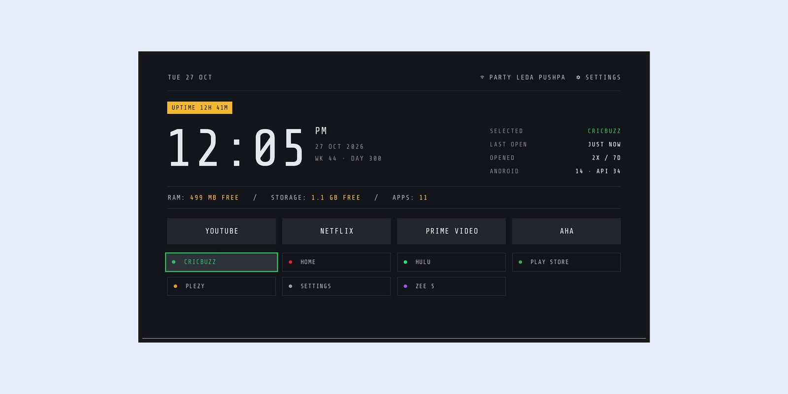
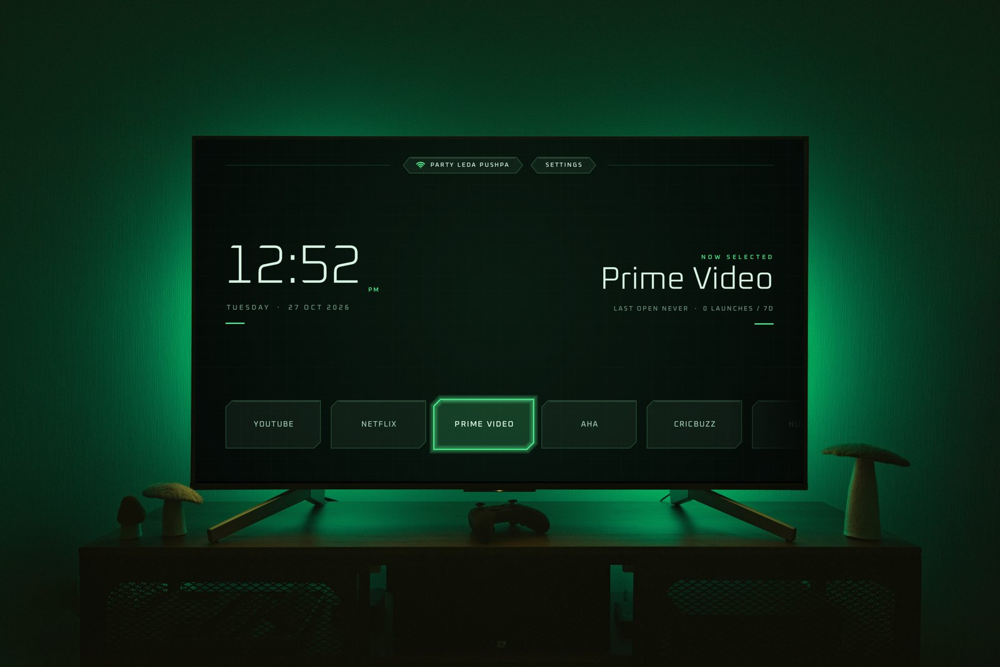
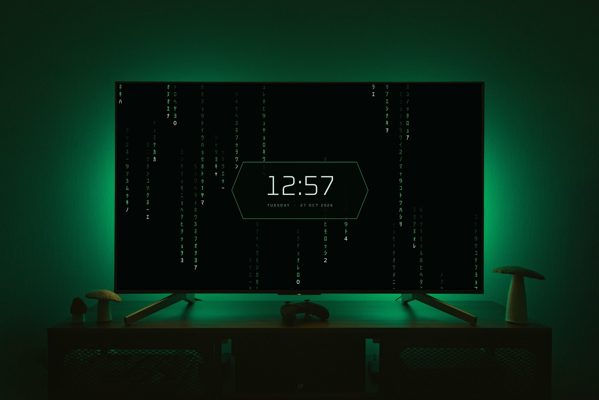
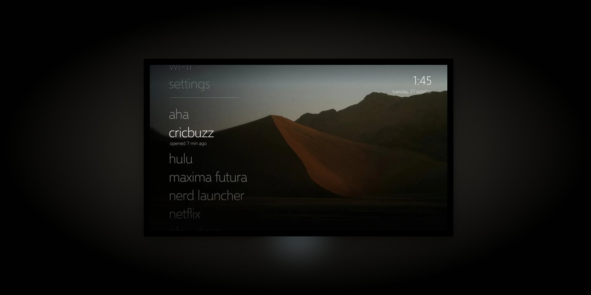

# tvlaunchers

Three lightweight Android TV home screens, each a standalone Gradle project with no dependencies.
Built and tested on a Chromecast with Google TV (Google TV 14); they also run as normal apps on Fire TV.

## Nerd Launcher

A text-only instrument dashboard in a Nerd Font, with per-app colours. Screensaver: the clock and readouts
with a blinking cursor. [Details](nerdlauncher/)



**[Download nerdlauncher-0.1-universal.apk](https://github.com/akhilmulpurii/tvlaunchers/raw/main/dist/nerdlauncher-0.1-universal.apk)** · `com.akhilmulpuri.nerdlauncher` · 68 KB

## Maxima Futura

A minimal frosted green HUD with hex tabs and text tiles. Screensaver: cmatrix-style digital rain behind a
frosted clock. [Details](maximafutura/)




**[Download maximafutura-0.1-universal.apk](https://github.com/akhilmulpurii/tvlaunchers/raw/main/dist/maximafutura-0.1-universal.apk)** · `com.akhilmulpuri.maximafutura` · 85 KB

## Zunesthetic

A Zune / Windows Phone style vertical list over a wallpaper. Screensaver: the wallpaper drifting, the day and
month in huge faint type, and a lock-screen clock. [Details](zunesthetic/)



**[Download zunesthetic-0.1-universal.apk](https://github.com/akhilmulpurii/tvlaunchers/raw/main/dist/zunesthetic-0.1-universal.apk)** · `com.akhilmulpuri.zunesthetic` · 290 KB

## All three

- Apps A-Z by default; **hold OK on an app** to move it or uninstall it, and the order is kept.
- No dependencies, no internet permission, nothing running in the background.
- One universal APK each: no native code, so the same APK runs on arm, arm64 and x86 TVs.
  Checksums: [`dist/SHA256SUMS`](dist/SHA256SUMS).

## Install

From a computer, with ADB debugging on the TV:

```bash
adb connect <tv-ip>
adb install -r nerdlauncher-0.1-universal.apk
```

On the TV itself: open the download link in a TV browser or a downloader app, then install the APK
(allow "install unknown apps" for that app when asked). Each launcher shows up as a normal app; see its
README to make it the Home screen and to pick its screensaver.

## Layout

```
nerdlauncher/  maximafutura/  zunesthetic/   one Gradle project each (own README)
tools/         build, release, keystore and relay scripts shared by all three
dist/          release APKs
screenshots/   originals; web/ has the resized copies the README uses
keystores/     release keys and passwords (git-ignored, back up separately)
```

## Build

Needs JDK 17 and Android SDK platform 34; `tools/env.sh` finds the JDK on macOS (Nix, Homebrew, Android Studio).

```bash
tools/build.sh zunesthetic                 # debug APK, dev key
tools/build.sh nerdlauncher installDebug   # any Gradle task
tools/release.sh                           # all three release APKs into dist/, with SHA256SUMS
```

## Signing

- **Release:** `keystores/<launcher>-release.p12` (PKCS12, RSA 4096, valid 30 years) with random passwords in
  `keystores/keystore.properties`. Create them on a fresh clone with `tools/make-keystores.sh`. The folder is
  git-ignored; **back it up**: an app can only be updated in place with the key it was first installed with.
- **Dev:** `<launcher>/signing/*.jks` (password `android`, git-ignored), used for debug builds so they keep
  installing over each other. Without release keys, release builds fall back to it.

Debug and release builds of the same launcher have different keys, so switching a TV from one to the other
means uninstalling first (which clears its saved order and launch history).

## Relay

`tools/relay.sh` runs in a normal terminal and executes only the `adb` calls and `@build <launcher> [tasks]`
jobs queued in `.relay/` (git-ignored), for coding assistants whose sandbox can't reach the TV or run Gradle.
